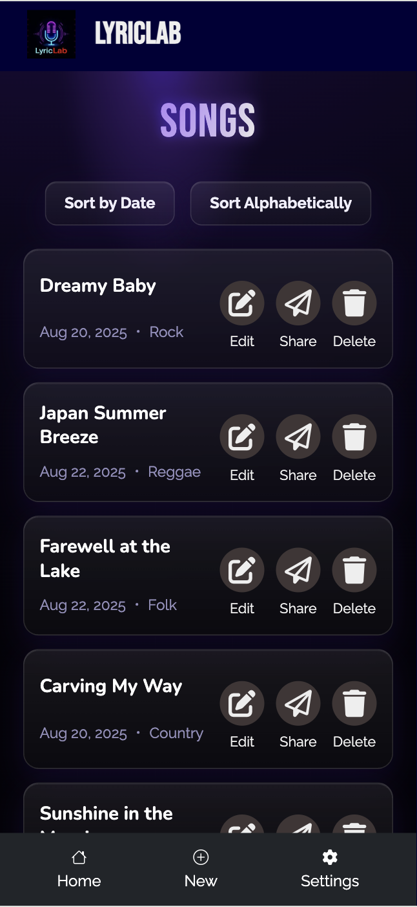
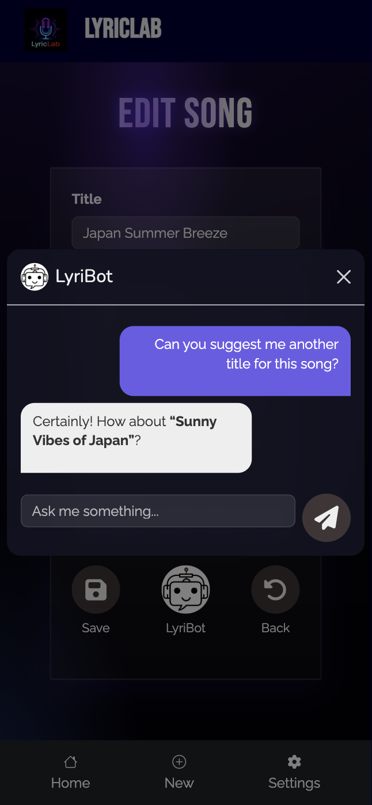

# 🎵 LyricLab

LyricLab is a collaborative lyric-writing platform built with Ruby on Rails.
It helps artists and music lovers create, edit, and share lyrics in an intuitive, distraction-free workspace.
Users can draft new songs, revisit past works, and explore creativity through a clean and simple interface.

<h2>Quick Look</h2>
<p align="center">
  
  
  
</p>

<details>
  <summary><strong>Show 3 more</strong></summary>
  <p align="center">
    
    
    
  </p>
</details>
<br>
App home: https://lyric-lab-b7e35a4bb8a8.herokuapp.com/

## Getting Started

### Setup

Install gems

```
bundle install
```

### ENV Variables

Create `.env` file

```
touch .env
```

Inside `.env`, set these variables. For any APIs, see group Slack channel.

```
CLOUDINARY_URL=your_own_cloudinary_url_key
```

### DB Setup

```
rails db:create
rails db:migrate
rails db:seed
```

### Run a server

```
rails s
```

## Built With

- [Rails 7](https://guides.rubyonrails.org/) - Backend / Front-end
- [Stimulus JS](https://stimulus.hotwired.dev/) - Front-end JS
- [Heroku](https://heroku.com/) - Deployment
- [PostgreSQL](https://www.postgresql.org/) - Database
- [Bootstrap](https://getbootstrap.com/) — Styling
- [Figma](https://www.figma.com) — Prototyping

## Acknowledgements

This app was built during our time at Le Wagon Tokyo Bootcamp.
We’d like to thank our instructors, TAs, and peers who encouraged us through every step of the journey.

## Team Members

- [Naing Oo Lwin](https://www.linkedin.com/in/nol0428/)
- [Paul Miyamoto](https://www.linkedin.com/in/paul-miyamoto-044711b9/)
- [Harry Salacuri](https://www.linkedin.com/in/harry-salacuri-7b13b6187/)
- [Liu Jiang](https://github.com/Vince-Liu-Jiang)

## Contributing

Pull requests are welcome. For major changes, please open an issue first to discuss what you would like to change.

## License

This project is licensed under the [MIT License](LICENSE).
